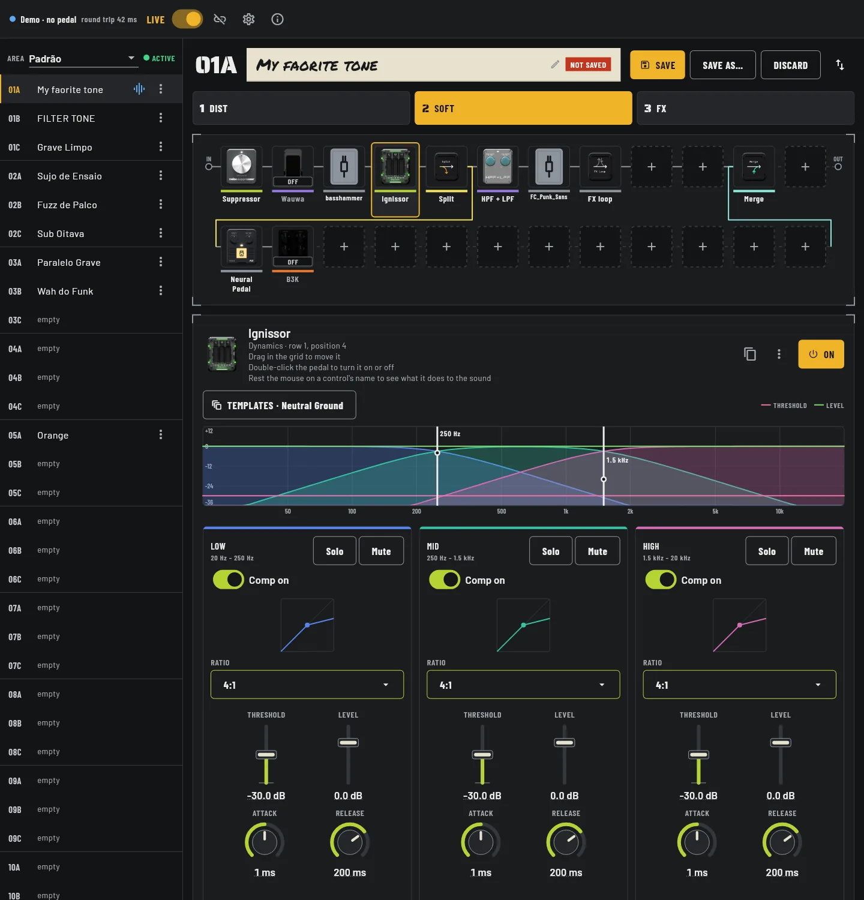
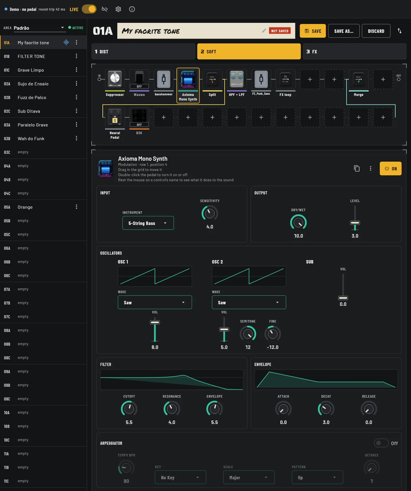
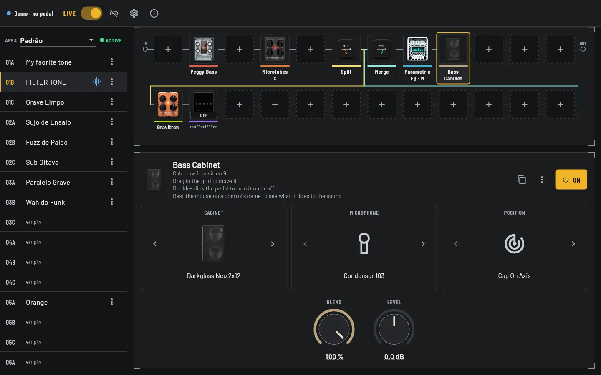
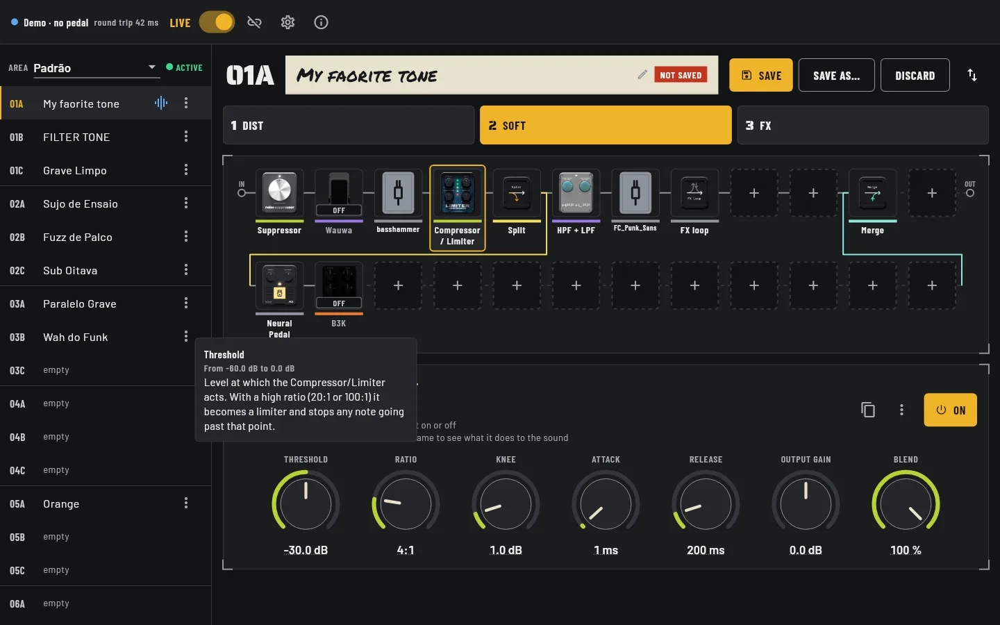
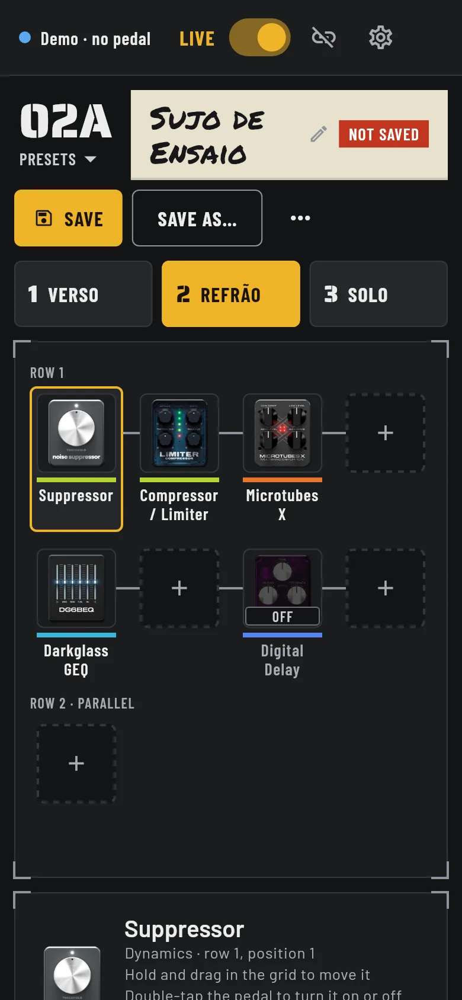

# Anagram App

**English** · [Português](README.pt-BR.md)

A **free and open-source** preset editor for the **Darkglass Anagram** bass multi-effects: presets by
bank, a signal chain with the pedal's own block art, big knobs, scenes and **live editing** over USB.
One Flutter codebase for macOS, Windows, Linux, Android and the browser (Chrome/Edge).

## Download

Current version: **0.2.0**. Pick the file for your computer; it's a zip, no installer.

| Your computer | File |
|---|---|
| **Windows 10/11** (64-bit) | [anagram-app-windows-0.2.0.zip](https://github.com/jordaobass/anagram_app/releases/download/v0.2.0/anagram-app-windows-0.2.0.zip) |
| **macOS · Apple Silicon** (M1, M2, M3, M4) | [anagram-app-macos-0.2.0.zip](https://github.com/jordaobass/anagram_app/releases/download/v0.2.0/anagram-app-macos-0.2.0.zip) |
| **macOS · Intel** (experimental, not tested on Intel hardware yet) | [anagram-app-macos-intel-0.2.0.zip](https://github.com/jordaobass/anagram_app/releases/download/v0.2.0/anagram-app-macos-intel-0.2.0.zip) |

**Which Mac do I have?** Apple menu () › **About This Mac**: "Chip Apple M…" = Apple Silicon; "Processor Intel…" =
Intel. The Apple Silicon build doesn't open on an Intel Mac (macOS says it "is not supported on this Mac").

- **Linux:** no ready-made build; build it from source (`flutter build linux`, see [Linux](#linux)).
  Experimental, not tested with the pedal; it may need a udev rule for the USB.
- **iPad / iPhone:** not yet. iPadOS doesn't let apps open the Anagram's USB.
- **All versions** and checksums: [Releases](https://github.com/jordaobass/anagram_app/releases/latest).

<p align="center">
  <a href="https://github.com/jordaobass/anagram_app/releases/latest"></a>
  <a href="https://github.com/jordaobass/anagram_app/releases"></a>
  <a href="LICENSE"></a>
  <a href="https://github.com/jordaobass/anagram_app/stargazers"></a>
</p>

<p align="center">
  <a href="https://jordaobass.github.io/anagram_app/"><strong>Website</strong></a> ·
  <a href="https://github.com/jordaobass/anagram_app/discussions">Discussions</a> ·
  <a href="https://github.com/jordaobass/anagram_app/issues/new">Suggest a feature</a>
</p>

<p align="center">
  <a href="https://jordaobass.github.io/anagram_app/"></a>
</p>

> **Unofficial app, not affiliated with Darkglass Electronics.** Anagram is a trademark of its
> manufacturer; the block art is used with Darkglass's permission.

No ads and no telemetry. The app talks to the pedal over USB; its only network call is an optional
check on launch (Windows, macOS and Linux) that asks GitHub for the latest release. That request
sends only the app's version (in the User-Agent header); as with any connection, GitHub sees your IP
address. It can be turned off in **Settings › Updates**.

The interface is in **English, Portuguese, Spanish and French** (it follows your system language; you can
change it in **Settings**, the gear icon).

## What you can do

| | |
|---|---|
| <br>**Multiband compressor (Ignissor)**: band curves, draggable Threshold and Level, Solo and Mute, a compression curve per band | <br>**Multiband drive (Entropia)**: Drive Type and Drive Mode like on the pedal, a waveform that saturates with the drive |
| <br>**Templates**: Darkglass's official ones for the Ignissor (6) and Entropia (17), with the values read from the pedal, plus starting points from the app, applied live with undo | <br>**Axioma Mono Synth**: oscillators, filter and envelope drawn live |
| <br>**Cabinets**: model photo, microphone and position, with a searchable gallery | <br>**Every control explained**: rest the mouse on its name to see what it does to the sound on that pedal |

<p align="center"><br><em>On a phone (Android) the chain becomes a compact grid.</em></p>

Also: a parallel row with Split and Merge, move/clone/swap presets and banks, clear a preset, export
and import JSON, the Factory area (36 Darkglass presets, read-only) and local AI via MCP.

On the desktop the app connects to the pedal on launch (switch it off in **Settings**). The footswitch
mode shows as **Stomp / Preset / Scene** pills on the scene row, next to a **Control: All scenes / Active
scene only** switch (like the pedal's Scene mode button: knobs and block on/off change every scene or only
the active one); the Auto Drummer and Cognate Metro
blocks are laid out like the pedal's own screen, with tap tempo; a TONE3000 block can switch to another
tone already on the pedal; menus have icons and are compact with a mouse; and live editing over USB is
faster. Output levels, Global EQ and input gain are shown **read-only**: the Anagram accepts those values
over USB but doesn't apply them to the sound, so adjust them on the pedal itself.

### New in 0.2.0

- **Local AI, fully live**: the assistant edits per scene (`scope`), reads and assigns footswitches,
  pots and the expression pedal, renames the preset and controls, lists, reads and opens slots, and starts
  a new preset in an empty slot. Saving is always confirmed by you in the app.
- **Control: All scenes / Active scene** switch, and presets with **more than 3 scenes** are kept whole
  and editable. The on/off label of a block says exactly in which scenes it is on or off (e.g. "OFF IN
  SCENES 1, 3").
- **Light theme**, or follow the system (**Settings**), and a new top bar: the pedal connection chip on
  the left, the gear on the right.
- **Backups**: the app saves a copy of a slot before writing over it (switch in **Settings › Preset
  backups**), can back up every preset at once, and opens a backup in the editor so you can restore it.
- **Darkglass Marketplace blocks** are read from the pedal itself (firmware 1.14 or newer), with their
  real parameters, and show up in the block library.
- **Official templates** of the Ignissor (6) and Entropia (17) with values read from the pedal; the
  Axioma templates are listed, their values are still to be read.
- The Ignissor and Entropia panels take on the pedal's metal look, and the Axioma its neon screen.
- **French** interface; on macOS the app asks for **Input Monitoring** the right way; **VS Code + GitHub
  Copilot** configuration in the AI settings.

## How to install

There's no installer: it's a folder you extract and open. Every version is in
**[Releases › latest](https://github.com/jordaobass/anagram_app/releases/latest)**: download the zip
for your system under **Assets**. (The green **Code** button downloads the source code, not the app.)

### Windows 10 or 11 (64-bit)

1. Download `anagram-app-windows-<version>.zip` from **Assets** in the
   [latest release](https://github.com/jordaobass/anagram_app/releases/latest).
2. In your Downloads folder, right-click the zip and choose **Extract All…**. Don't run the app from
   inside the zip: it needs the other files in the folder.
3. Move the **Anagram App** folder wherever you like (e.g. `Documents`) and open **Anagram App.exe**.
4. The first time, Windows may show **"Windows protected your PC"**, because the app isn't signed yet.
   Click **More info › Run anyway**. This only shows up once.
5. To find it easily later: right-click `Anagram App.exe` › **Show more options › Send to › Desktop
   (create shortcut)**, or **Pin to Start**.

Keep all the files together in the folder: `hidapi.dll` talks to the pedal over USB, and the
`vcruntime`/`msvcp` files let the app open on PCs without the Visual C++ runtime.

- **Update:** close the app, delete the old folder and extract the new one in its place. Presets live on
  the pedal, not in the app, so nothing is lost.
- **Uninstall:** delete the folder (and the shortcut, if you made one). The app writes nothing to the
  registry.

### macOS (Apple Silicon or Intel)

1. Download the zip for your Mac (see [Download](#download)): `anagram-app-macos-<version>.zip` for
   Apple Silicon (M1–M4), `anagram-app-macos-intel-<version>.zip` for Intel. Double-click it to extract.
2. Drag **Anagram App** to **Applications**.
3. The first time, macOS blocks it because the app isn't notarized yet: open **System Settings ›
   Privacy & Security** and click **Open Anyway**. Or, in Terminal:
   `xattr -cr "/Applications/Anagram App.app"`.

#### macOS: first launch

- **"Apple could not verify…"**: the app isn't signed by Apple yet. Open **System Settings › Privacy &
  Security** and click **Open Anyway** (or run `xattr -cr "/Applications/Anagram App.app"` in Terminal).
- **Input Monitoring**: macOS treats the Anagram's USB access as Input Monitoring. The first time you
  click **Connect over USB**, macOS asks for it; the app doesn't open the USB until it is allowed. If it
  isn't, the connect screen says so and has an **Open System Settings** button: turn **Anagram App** on in
  **System Settings › Privacy & Security › Input Monitoring**, then quit and reopen the app (macOS only
  applies it on the next launch).

### Linux

There's no ready-made build yet; build it from source with `flutter build linux` (see
[the app README](mobile/README.md)). Experimental: it hasn't been tested with the pedal. Install
`libhidapi-hidraw0` and, if the app can't open the USB, a udev rule that gives your user access to the
Anagram's USB device.

### Connecting to the pedal for the first time

1. **Close the Darkglass Suite** (and any browser tab connected to the Anagram): only one program at a
   time can talk to it.
2. On the pedal, open the **MIDI** settings and turn on **USB MIDI**. That's how the app switches slots
   when you click a preset; without it the app can only preview a preset while the pedal stays on its
   own slot.
3. Connect the Anagram to your computer with the USB cable, open the app and click **Connect over USB**
   (on the desktop the app already tries once on launch: "Looking for the pedal…"). The top bar shows the firmware version once connected.
4. Click a preset in the list to open it. To build the chain, use the **+** in an empty slot (it opens
   the effects library) and drag blocks to change their order. **Save** writes it to the slot.

No pedal? **Open demo** simulates an Anagram in memory so you can explore the app.

## Local AI via MCP (optional, desktop only)

The app can take requests from an AI assistant running on your own computer (LM Studio, Claude Desktop,
VS Code with GitHub Copilot or any other MCP client): *"make the low end fuller"*, *"build me a slap tone"*. The AI reads the open
preset and adjusts the blocks; every change is **heard immediately**, shows up on screen and stays
**unsaved**. Nothing is written to the pedal unless you confirm it in the app.

1. Open **Settings** (gear icon in the top bar) and turn on **Allow AI via MCP**. The app then listens
   only on your own computer, at `http://127.0.0.1:8765/mcp`, and requires the token shown there.
2. Click **Copy configuration for** your client and paste it into its MCP file. In LM Studio
   (`mcp.json`):

   ```json
   {
     "mcpServers": {
       "anagram": {
         "url": "http://127.0.0.1:8765/mcp",
         "headers": { "Authorization": "Bearer <token from Settings>" }
       }
     }
   }
   ```

   Claude Desktop only speaks stdio, so the copied configuration uses the bridge
   `npx -y mcp-remote <url> --transport http-only --header "Authorization: Bearer <token>"`.

   **VS Code + GitHub Copilot**: the copied configuration goes into `~/.copilot/mcp-config.json` (or
   **Chat: Open Customizations › MCP Servers › Copilot Global**), in the format of the
   [VS Code MCP reference](https://code.visualstudio.com/docs/copilot/reference/mcp-configuration):

   ```json
   {
     "mcpServers": {
       "anagram": {
         "type": "http",
         "url": "http://127.0.0.1:8765/mcp",
         "headers": { "Authorization": "Bearer <token from Settings>" },
         "tools": ["*"]
       }
     }
   }
   ```

   The Copilot app on Windows and Microsoft 365 Copilot have no place to add a local MCP server: use
   GitHub Copilot inside VS Code.

   **Any other client**: Streamable HTTP transport, the URL above and the header
   `Authorization: Bearer <token>` (that's what **Other client** copies).
3. Open a preset in the app and talk to the AI.

> **The AI can't hear the sound**: it adjusts based on what you describe, and you tell it whether it
> got better. Small models tend to describe what they would do instead of calling the tools; prefer a
> model with good tool calling. Tools: `get_current_preset`, `list_block_types`, `get_block_guide`,
> `get_tone_building_guide`, `get_tone_recipe`, `set_parameter` and `set_block_enabled` (with `scope`: only
> the active scene or all scenes; without it, the app's Control switch), `select_scene`, `add_block`, `move_block`, `remove_block`,
> `choose_cabinet`, `get_controls`, `assign_control` and `release_control` (footswitches, knobs and
> expression pedal; footswitches follow them in Stomp mode), `rename` (preset or control),
> `list_slots`, `read_slot` (without opening), `open_slot` (refuses over unsaved edits unless told to
> discard them; on an empty slot it starts a new preset there), `undo`, `save_preset` (always confirmed by you in the app), `get_global_settings`
> (read only) and `set_global_setting` (footswitch mode only).

**The app teaches the AI the pedal.** It ships a tone-building knowledge base that the assistant reads
through the same connection: what each of the 109 factory blocks does (role, key parameters with
ranges, a starting point and pitfalls, via `get_block_guide`), how to build a bass chain (order, gain
staging, the parallel line, EQ by frequency, compression, drive, cabinets, scenes, via
`get_tone_building_guide`) and starting recipes by style or player reference ("funk slap", "modern
metal", "Steve Harris", via `get_tone_recipe`). The connection also carries a recommended flow: read
the preset, ask, propose, apply in small steps, let you listen, and only save when you say so. For
Claude Desktop or Claude Code there is a ready-made skill in [`docs/ia/SKILL.md`](docs/ia/SKILL.md),
which also has a system prompt to paste into LM Studio.

## Repository layout

| Folder | What's in it |
|---|---|
| [`mobile/`](mobile/) | The Flutter app (all platforms): code, tests, reference screenshots and tools. Start with [the app README](mobile/README.md). |
| [`docs/`](docs/) | [`DECISOES.md`](docs/DECISOES.md), the single log of product and technical decisions (open and closed, with dates and where they landed). |

The code, comments and internal docs are written in Portuguese (pt-BR), where the project started.

## Quick start

```bash
cd mobile
flutter pub get
flutter test          # protocol, failure modes, end-to-end paths and screenshots
flutter run -d macos  # or windows, linux, chrome, a connected Android device
```

No pedal? **Open demo** simulates an Anagram in memory.

## Third-party art

The block art, cabinet photos and factory presets belong to **Darkglass Electronics** (the same ones
the pedal shows on its screen). They live in `mobile/assets/blocos_terceiros/` and are **published with
Darkglass's permission**. Images are downsized (max 256 px, compressed PNG) and regenerated from the
Darkglass Suite by `mobile/ferramentas/baixar_arte_pedaleira.py`;
`mobile/ferramentas/verificar_release.sh` rejects any file in that folder that isn't this art.
Darkglass Marketplace plugins use each product's public store image, credited to its maker on the
About screen (`mobile/ferramentas/baixar_arte_marketplace.py`); TONE3000 factory tones show their
photo from the Suite. Internal utilities (tuner, mixer, meters, MIDI…) get icons drawn by the app.

## Contributing

Issues, ideas and pull requests are welcome, in English, Portuguese or Spanish. See
[`CONTRIBUTING.md`](CONTRIBUTING.md) to run the project, report bugs and send PRs.

## Credits and license

USB protocol, block catalog and example presets ported from
[anagram-tone-maker](https://github.com/basster6/anagram-tone-maker) (MIT); the AI block guide also
draws on the community block attributions that project collected (kept as hints, not as Darkglass
statements). Project license:
[MIT](LICENSE). The block art is © Darkglass Electronics, used with permission, and is not covered by
the MIT license.
