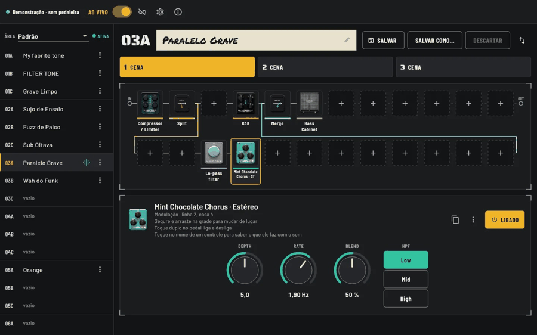
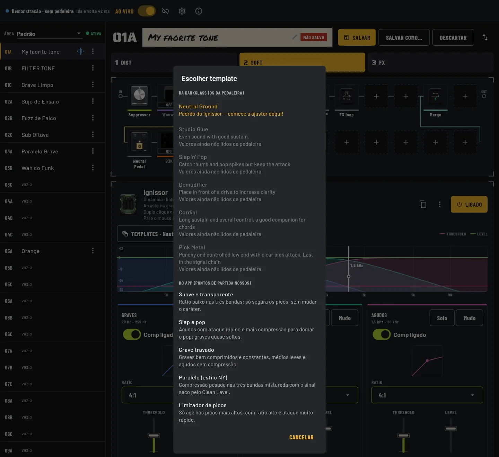
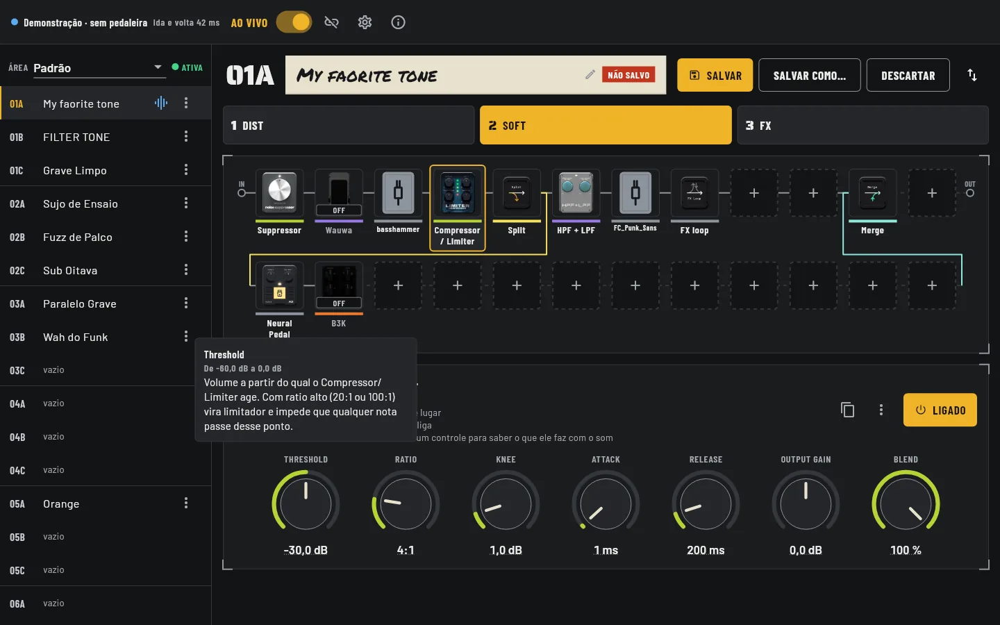
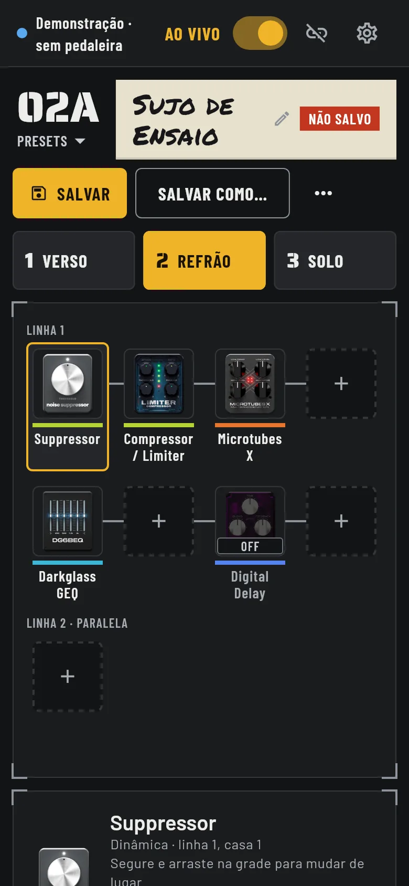

# Anagram App

[English](README.md) · **Português**

Editor de presets **gratuito e open source** para a pedaleira de baixo **Darkglass Anagram**:
lista de presets por banco, cadeia de blocos com a arte da pedaleira, knobs grandes, cenas e edição
**ao vivo** pelo USB. Um código Flutter só para macOS, Windows, Linux, Android e navegador (Chrome/Edge).

<p align="center">
  <a href="https://github.com/jordaobass/anagram_app/releases/latest"></a>
  <a href="https://github.com/jordaobass/anagram_app/releases/latest"></a>
</p>

<p align="center">
  <a href="https://github.com/jordaobass/anagram_app/releases/latest"></a>
  <a href="https://github.com/jordaobass/anagram_app/releases"></a>
  <a href="LICENSE"></a>
  <a href="https://github.com/jordaobass/anagram_app/stargazers"></a>
</p>

<p align="center">
  <a href="https://jordaobass.github.io/anagram_app/"><strong>Site</strong></a> ·
  <a href="https://github.com/jordaobass/anagram_app/discussions">Discussions</a> ·
  <a href="https://github.com/jordaobass/anagram_app/issues/new">Sugerir uma funcionalidade</a>
</p>

<p align="center">
  <a href="https://jordaobass.github.io/anagram_app/"></a>
</p>

> **App não oficial, sem vínculo com a Darkglass Electronics.** Anagram é marca do fabricante; a arte
> dos blocos é usada com autorização da Darkglass.

Sem anúncios e sem telemetria. O app conversa com a pedaleira pelo USB; a única chamada de rede é
uma verificação opcional ao abrir (Windows, macOS e Linux) que pergunta ao GitHub qual é a última
versão. Essa consulta envia apenas a versão do app (no cabeçalho User-Agent); como em toda conexão,
o GitHub vê o seu endereço IP. Ela pode ser desligada em **Configurações › Atualizações**.

Interface em **português, inglês, espanhol e francês** (segue o idioma do sistema; dá para trocar em
**Configurações**, na engrenagem).

## O que dá para fazer

| | |
|---|---|
| <br>**Compressor multibanda (Ignissor)** — curvas das três bandas, Threshold e Level arrastáveis, Solo e Mudo, curva de compressão por banda | <br>**Drive multibanda (Entropia)** — Drive Type e Drive Mode como na pedaleira, onda que satura com o drive |
| <br>**Templates** — os oficiais da Darkglass do Ignissor (6) e do Entropia (17), com os valores lidos da pedaleira, e pontos de partida do app, aplicados ao vivo com desfazer | <br>**Axioma Mono Synth** — osciladores, filtro e envelope desenhados ao vivo |
| <br>**Gabinetes** — foto do modelo, microfone e posição, com galeria e busca | <br>**Explicação de cada controle** — pare o mouse no nome e veja o que ele faz com o som naquele pedal |

<p align="center"><br><em>No celular (Android) a cadeia vira uma grade compacta.</em></p>

Também: linha paralela com Split e Merge, mover/clonar/trocar presets e bancos, limpar preset,
exportar e importar JSON, área Fábrica (36 presets da Darkglass, só leitura) e IA local via MCP.

No computador o app conecta na pedaleira ao abrir (dá para desligar em **Configurações**). O modo dos
footswitches aparece em pílulas **Stomp / Preset / Scene** na linha das cenas, ao lado da chave
**Controlar: Todas as cenas / Só a cena ativa** (como o botão do modo Scene da pedaleira: knobs e
liga/desliga do bloco mudam todas as cenas ou só a ativa); os blocos Auto Drummer e
Cognate Metro ficam dispostos como na tela da própria pedaleira, com tap tempo; um bloco TONE3000 troca
para outro tom que já está na pedaleira; os menus têm ícones e ficam compactos com mouse; e a edição ao
vivo pelo USB ficou mais rápida. Volume das saídas, Global EQ e ganho de entrada aparecem **só para
leitura**: a Anagram aceita esses valores pelo USB, mas não os aplica ao som, então ajuste na própria
pedaleira.

### Novidades da 0.2.0

- **IA local completa, ao vivo**: o assistente edita por cena (`scope`), lê e atribui footswitches, pots
  e pedal de expressão, renomeia o preset e os controles, lista, lê e abre slots e cria um preset novo num
  slot vazio. Salvar sempre passa pela sua confirmação no app.
- Chave **Controlar: Todas as cenas / Só a cena ativa**, e presets com **mais de 3 cenas** são preservados
  inteiros e editáveis. O rótulo de liga/desliga do bloco diz exatamente em quais cenas ele está ligado ou
  desligado (ex.: "DESLIGADO NAS CENAS 1, 3").
- **Tema claro**, ou seguir o sistema (**Configurações**), e barra superior nova: o chip da conexão com a
  pedaleira à esquerda, a engrenagem à direita.
- **Backups**: o app guarda uma cópia do slot antes de gravar por cima (interruptor em **Configurações ›
  Backup dos presets**), faz backup de todos os presets de uma vez e abre um backup no editor para
  restaurar.
- **Blocos do Darkglass Marketplace** lidos da própria pedaleira (firmware 1.14 ou mais novo), com os
  parâmetros reais, e listados na biblioteca de blocos.
- **Templates oficiais** do Ignissor (6) e do Entropia (17) com valores lidos da pedaleira; os do Axioma
  estão listados, com os valores ainda por ler.
- Os painéis do Ignissor e do Entropia ganham o visual metálico da pedaleira, e o do Axioma a tela neon.
- Interface em **francês**; no macOS o app pede o **Monitoramento de Entrada** do jeito certo;
  configuração para **VS Code + GitHub Copilot** nos ajustes de IA.

## Como instalar

O app não tem instalador: é uma pasta que você extrai e abre. Todas as versões ficam em
**[Releases › última versão](https://github.com/jordaobass/anagram_app/releases/latest)**: baixe o zip
do seu sistema em **Assets**. (O botão verde **Code** baixa o código-fonte, não o app.)

### Windows 10 ou 11 (64 bits)

1. Abra a [última versão](https://github.com/jordaobass/anagram_app/releases/latest) e, em **Assets**,
   baixe `anagram-app-windows-<versão>….zip`.
2. Na pasta Downloads, clique com o botão direito no zip e escolha **Extrair Tudo…**. Não abra o app de
   dentro do zip: ele precisa dos outros arquivos da pasta.
3. Mova a pasta **Anagram App** para onde quiser (ex. `Documentos`) e abra **Anagram App.exe**.
4. Na primeira vez, o Windows pode mostrar **"O Windows protegeu o computador"**, porque o app ainda não
   é assinado. Clique em **Mais informações › Executar assim mesmo**. Isso só aparece uma vez.
5. Para achar fácil depois: botão direito em `Anagram App.exe` › **Mostrar mais opções › Enviar para ›
   Área de trabalho (criar atalho)**, ou **Fixar em Iniciar**.

Mantenha todos os arquivos juntos na pasta: a `hidapi.dll` é quem fala com a pedaleira pelo USB, e as
`vcruntime`/`msvcp` fazem o app abrir em PCs sem o runtime do Visual C++.

- **Atualizar:** feche o app, apague a pasta antiga e extraia a nova no lugar. Os presets ficam na
  pedaleira, não no app, então nada se perde.
- **Desinstalar:** apague a pasta (e o atalho, se criou). O app não grava nada no registro.

### macOS (Apple Silicon, M1 ou mais novo)

1. Baixe o zip do macOS na [última versão](https://github.com/jordaobass/anagram_app/releases/latest)
   (quando houver build para a versão) e dê dois cliques para extrair.
2. Arraste **Anagram App** para **Aplicativos**.
3. Na primeira vez, o macOS bloqueia porque o app ainda não é notarizado: abra **Ajustes do Sistema ›
   Privacidade e Segurança** e clique em **Abrir Mesmo Assim**. Ou, no Terminal:
   `xattr -cr "/Applications/Anagram App.app"`.

#### macOS: primeira abertura

- **"A Apple não pôde verificar…"**: o app ainda não é assinado pela Apple. Abra **Ajustes do Sistema ›
  Privacidade e Segurança** e clique em **Abrir Mesmo Assim** (ou rode
  `xattr -cr "/Applications/Anagram App.app"` no Terminal).
- **Monitoramento de Entrada**: o macOS trata o acesso USB da Anagram como Monitoramento de Entrada. Na
  primeira vez que você clica em **Conectar pelo USB**, o macOS pede essa permissão; o app só abre o USB
  depois de liberado. Se não estiver, a tela de conectar avisa e traz o botão **Abrir Ajustes**: ligue o
  **Anagram App** em **Ajustes do Sistema › Privacidade e Segurança › Monitoramento de Entrada** e depois
  feche e reabra o app (o macOS só aplica na próxima abertura).

### Linux

Ainda não há build pronto; compile pelo [README do app](mobile/README.md#desenvolvimento). Instale a
`libhidapi-hidraw0` e uma regra udev que dê acesso ao USB da Anagram ao seu usuário.

### Primeira conexão com a pedaleira

1. **Feche o Darkglass Suite** (e qualquer aba do navegador conectada à Anagram): só um programa por vez
   fala com ela.
2. Na pedaleira, abra os ajustes de **MIDI** e ligue o **USB MIDI**. É por ele que o app troca de slot
   quando você toca num preset; sem ele, o app só deixa ouvir o preset sem a pedaleira mudar de slot.
3. Ligue a Anagram no computador pelo cabo USB, abra o app e clique em **Conectar pelo USB**
   (no computador o app já tenta uma vez ao abrir: "Procurando a pedaleira…"). A barra de cima mostra o firmware quando conecta.
4. Toque num preset da lista para abrir. Para montar a cadeia, use o **+** de uma casa vazia (abre a
   biblioteca de efeitos) e arraste os blocos para mudar a ordem. **Salvar** grava no slot.

Sem pedaleira, **Abrir demonstração** simula uma Anagram em memória para você conhecer o app.

> O app traz a arte dos blocos da Darkglass Electronics, a mesma da tela da pedaleira, publicada com
> autorização da Darkglass (veja [Arte de terceiros](#arte-de-terceiros)).

## IA local via MCP (opcional, só no computador)

O app pode receber pedidos de um assistente de IA que roda no seu computador (LM Studio, Claude Desktop,
VS Code com GitHub Copilot ou outro cliente com suporte a MCP): *"deixa o grave mais encorpado"*, *"monta um timbre de slap"*. A IA lê o
preset aberto e mexe nos blocos; cada mudança **soa na hora**, aparece na tela e fica **não salva**. Gravar
na pedaleira só acontece se você confirmar no app.

1. Abra **Configurações** (engrenagem na barra de cima) e ligue **Permitir IA via MCP**. O app passa a
   escutar só no próprio computador, em `http://127.0.0.1:8765/mcp`, e exige o token mostrado ali.
2. Clique em **Copiar configuração para** o seu cliente e cole no arquivo de MCP dele. No LM Studio
   (`mcp.json`):

   ```json
   {
     "mcpServers": {
       "anagram": {
         "url": "http://127.0.0.1:8765/mcp",
         "headers": { "Authorization": "Bearer <token das Configurações>" }
       }
     }
   }
   ```

   No Claude Desktop, que só fala stdio, a configuração copiada usa a ponte
   `npx -y mcp-remote <url> --transport http-only --header "Authorization: Bearer <token>"`.

   **VS Code + GitHub Copilot**: a configuração copiada vai em `~/.copilot/mcp-config.json` (ou em
   **Chat: Open Customizations › MCP Servers › Copilot Global**), no formato da
   [referência de MCP do VS Code](https://code.visualstudio.com/docs/copilot/reference/mcp-configuration):

   ```json
   {
     "mcpServers": {
       "anagram": {
         "type": "http",
         "url": "http://127.0.0.1:8765/mcp",
         "headers": { "Authorization": "Bearer <token das Configurações>" },
         "tools": ["*"]
       }
     }
   }
   ```

   O app Copilot do Windows e o Microsoft 365 Copilot não têm onde colar um servidor MCP local: use o
   GitHub Copilot dentro do VS Code.

   **Outro cliente**: transporte Streamable HTTP, a URL acima e o cabeçalho
   `Authorization: Bearer <token>` (é o que **Outro cliente** copia).
3. Abra um preset no app e converse com a IA.

> **A IA não ouve o som**: ela ajusta pelo que você descreve, e você diz se melhorou. Modelos pequenos
> costumam descrever o que fariam em vez de chamar as ferramentas; prefira um modelo com bom suporte a
> ferramentas (*tool calling*). Ferramentas: `get_current_preset`, `list_block_types`, `get_block_guide`,
> `get_tone_building_guide`, `get_tone_recipe`, `set_parameter` e `set_block_enabled` (com `scope`: só a
> cena ativa ou todas as cenas; sem ele, vale a chave Controlar do app), `select_scene`, `add_block`, `move_block`, `remove_block`,
> `choose_cabinet`, `get_controls`, `assign_control` e `release_control` (footswitches, pots e pedal de
> expressão; os footswitches obedecem no modo Stomp), `rename` (preset ou controle), `list_slots`,
> `read_slot` (sem abrir), `open_slot` (recusa por cima de edição não salva, a menos que a IA diga para
> descartar; num slot vazio, começa um preset novo ali), `undo`, `save_preset` (sempre confirmado por você no app), `get_global_settings` (só
> leitura) e `set_global_setting` (só o modo dos footswitches) (decisões IA1–IA7, IC1–IC9 e IM1–IM7 em
> `docs/DECISOES.md`).

**O app ensina a pedaleira à IA.** Ele traz uma base de conhecimento de timbre que o assistente lê pela
mesma conexão: o que cada um dos 109 blocos de fábrica faz (papel, parâmetros que importam com faixas,
ponto de partida e armadilhas, por `get_block_guide`), como montar uma cadeia de baixo (ordem, gain
staging, linha paralela, EQ por frequência, compressão, drive, gabinetes, cenas, por
`get_tone_building_guide`) e receitas de partida por estilo ou baixista de referência ("slap", "metal
moderno", "Steve Harris", por `get_tone_recipe`). A conexão também leva o fluxo recomendado: ler o
preset, perguntar, propor, aplicar em passos pequenos, deixar você ouvir e só gravar quando você disser.
Para Claude Desktop ou Claude Code há uma skill pronta em [`docs/ia/SKILL.md`](docs/ia/SKILL.md), que
também traz um prompt de sistema para colar no LM Studio. O conteúdo é em inglês de propósito: é o
idioma em que os modelos seguem melhor as ferramentas.

## Organização do repositório

| Pasta | O que tem |
|---|---|
| [`mobile/`](mobile/) | O app Flutter (todas as plataformas): código, testes, capturas de referência e ferramentas. Comece pelo [README do app](mobile/README.md). |
| [`docs/`](docs/) | [`DECISOES.md`](docs/DECISOES.md), o registro único das decisões de produto e técnicas (abertas e fechadas, com data e onde aterrissaram), e a pesquisa de referência de interface. |

## Começo rápido

```bash
cd mobile
flutter pub get
flutter test          # núcleo, modos de falha, caminho ponta a ponta e capturas
flutter run -d macos  # ou windows, linux, chrome, um Android conectado
```

Sem pedaleira, o botão **Abrir demonstração** simula uma Anagram em memória.

## Arte de terceiros

A arte dos blocos, as fotos dos gabinetes e os presets de fábrica são da **Darkglass Electronics** (os
mesmos que a pedaleira mostra na tela) e ficam em `mobile/assets/blocos_terceiros/`, **publicados com
autorização da Darkglass**. As imagens são reduzidas (no máximo 256 px, PNG comprimido) e são regeradas
do Darkglass Suite por `mobile/ferramentas/baixar_arte_pedaleira.py`;
`mobile/ferramentas/verificar_release.sh` recusa qualquer arquivo na pasta que não seja dessa arte.
Decisões A9 a A16 em [`docs/DECISOES.md`](docs/DECISOES.md).

## Contribuir

Issues, ideias e pull requests são bem-vindos, em português, inglês ou espanhol. Veja
[`CONTRIBUTING.md`](CONTRIBUTING.md) (em inglês) para rodar o projeto, reportar bugs e mandar PRs.

## Créditos e licença

Protocolo USB, catálogo de blocos e presets de exemplo portados do
[anagram-tone-maker](https://github.com/basster6/anagram-tone-maker) (MIT); o guia de blocos da IA
também aproveita as atribuições da comunidade que esse projeto reuniu (como pistas, não como afirmação
da Darkglass). Licença do projeto:
[MIT](LICENSE).
