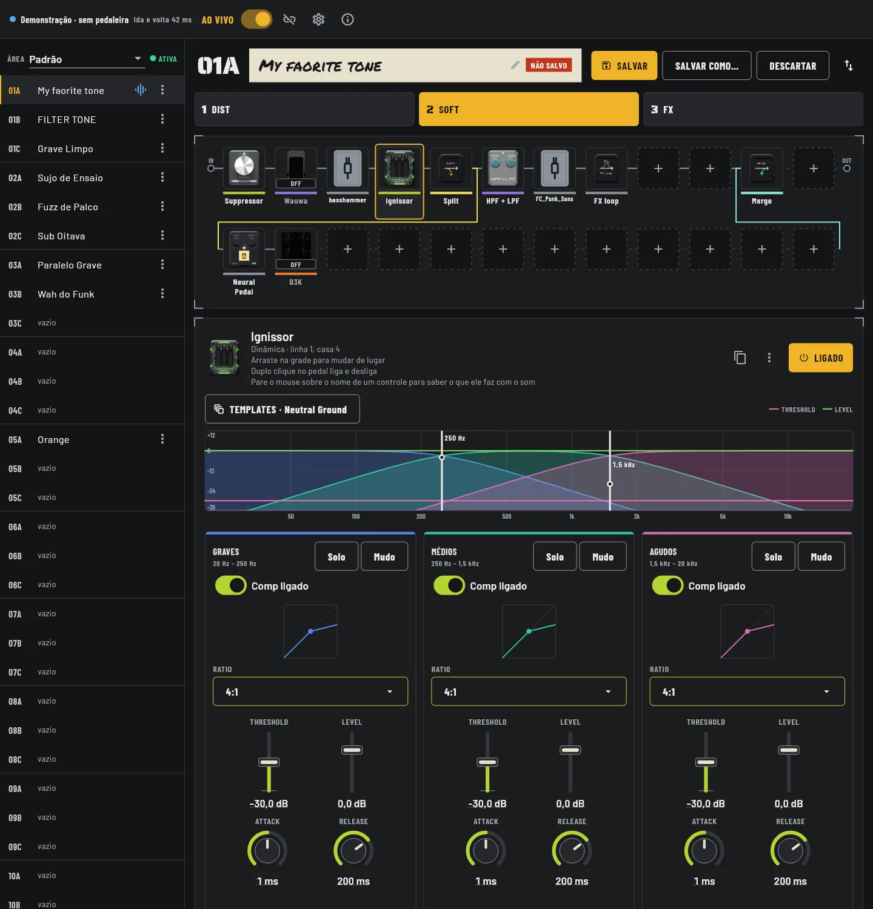
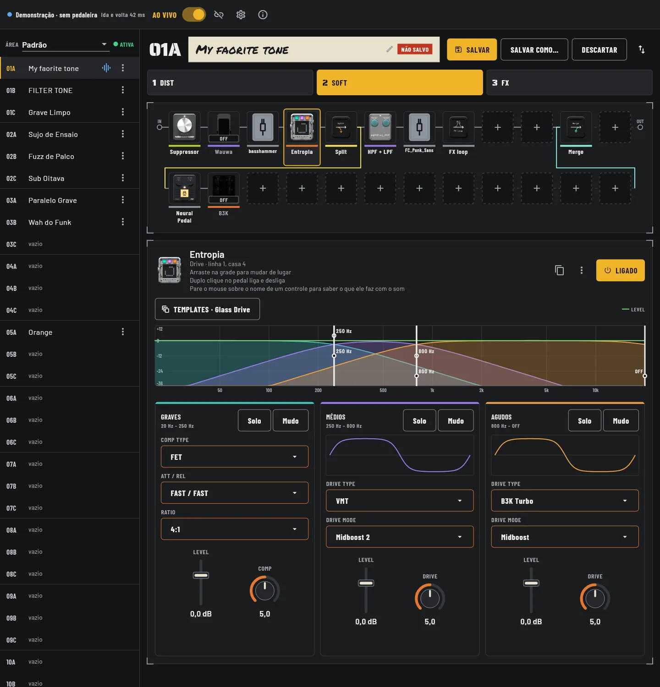
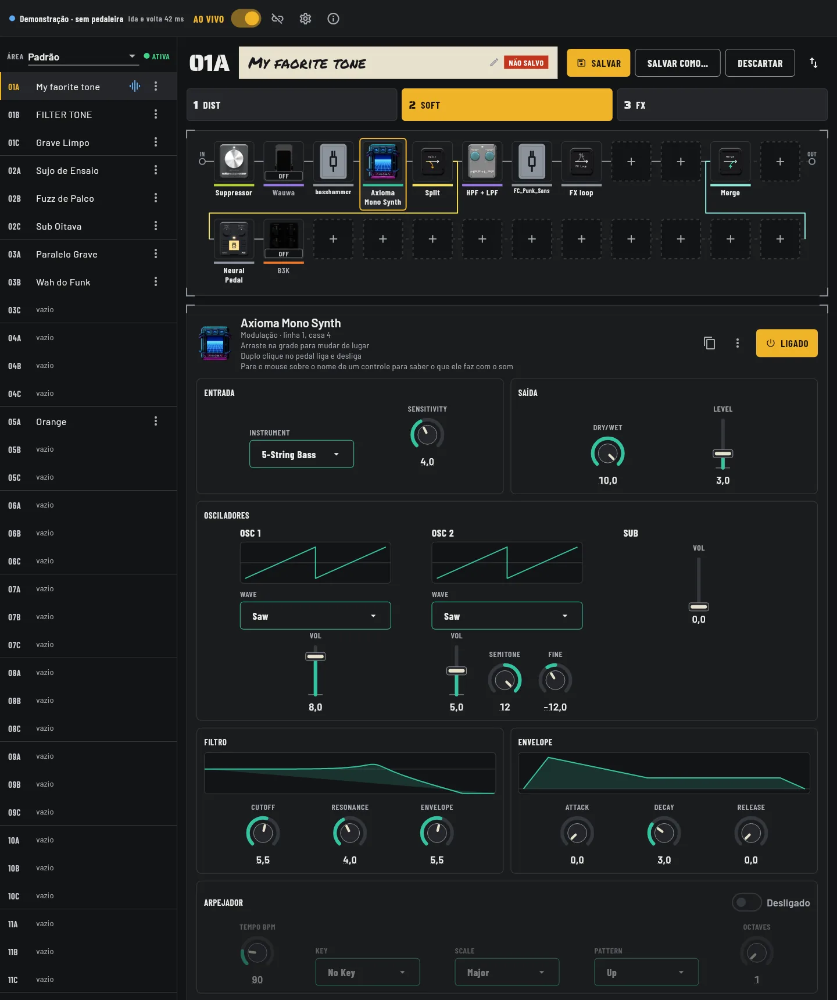
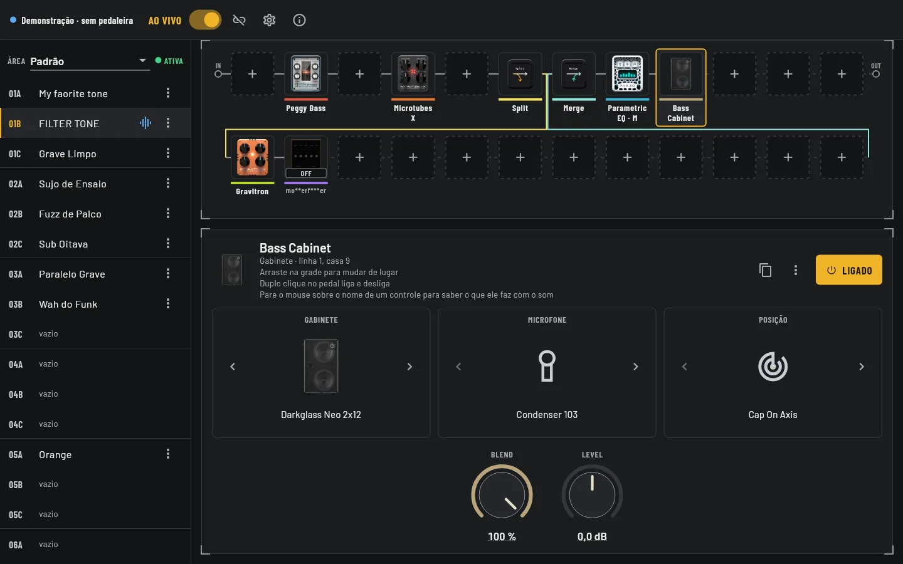

# Anagram App

[English](README.md) · **Português**

Editor de presets **gratuito e open source** para a pedaleira de baixo **Darkglass Anagram**:
lista de presets por banco, cadeia de blocos com a arte da pedaleira, knobs grandes, cenas e edição
**ao vivo** pelo USB. Um código Flutter só para macOS, Windows, Linux, Android e navegador (Chrome/Edge).

<p align="center">
  <a href="https://s3.nexttag.app/apps/desktop/anagram-app/index.html"></a>
  <a href="https://s3.nexttag.app/apps/desktop/anagram-app/index.html"></a>
  <a href="https://github.com/jordaobass/anagram_app/releases/latest"></a>
</p>

<p align="center">
  <a href="https://s3.nexttag.app/apps/desktop/anagram-app/index.html"></a>
</p>

> **App não oficial, sem vínculo com a Darkglass Electronics.** Anagram é marca do fabricante; a arte
> dos blocos é usada com autorização da Darkglass.

Sem anúncios, sem telemetria e sem chamadas de rede: o app só conversa com a pedaleira pelo USB.

Interface em **português, inglês e espanhol** (segue o idioma do sistema; dá para trocar em
**Configurações**, na engrenagem).

## O que dá para fazer

| | |
|---|---|
| <br>**Compressor multibanda (Ignissor)** — curvas das três bandas, Threshold e Level arrastáveis, Solo e Mudo, curva de compressão por banda | <br>**Drive multibanda (Entropia)** — Drive Type e Drive Mode como na pedaleira, onda que satura com o drive |
| <br>**Templates** — os da Darkglass e pontos de partida do app, aplicados ao vivo com desfazer | <br>**Axioma Mono Synth** — osciladores, filtro e envelope desenhados ao vivo |
| <br>**Gabinetes** — foto do modelo, microfone e posição, com galeria e busca | <br>**Explicação de cada controle** — pare o mouse no nome e veja o que ele faz com o som naquele pedal |

<p align="center"><br><em>No celular (Android) a cadeia vira uma grade compacta.</em></p>

Também: linha paralela com Split e Merge, mover/clonar/trocar presets e bancos, limpar preset,
exportar e importar JSON, área Fábrica (36 presets da Darkglass, só leitura) e IA local via MCP.

## Como instalar

O app não tem instalador: é uma pasta que você extrai e abre. Todas as versões ficam em
**[Releases › última versão](https://github.com/jordaobass/anagram_app/releases/latest)**.

### Windows 10 ou 11 (64 bits)

1. Abra a [última versão](https://github.com/jordaobass/anagram_app/releases/latest) e, em **Assets**,
   baixe `anagram-app-windows-<versão>….zip`.
2. Na pasta Downloads, clique com o botão direito no zip e escolha **Extrair Tudo…**. Não abra o app de
   dentro do zip: ele precisa dos outros arquivos da pasta.
3. Mova a pasta **Anagram App** para onde quiser (ex. `Documentos`) e abra **Anagram App.exe**.
4. Na primeira vez, o Windows pode mostrar **"O Windows protegeu o computador"**, porque o app ainda não
   é assinado. Clique em **Mais informações › Executar assim mesmo**. Isso só aparece uma vez.
5. Para achar fácil depois: botão direito em `Anagram App.exe` › **Mostrar mais opções › Enviar para ›
   Área de trabalho (criar atalho)**, ou **Fixar em Iniciar**.

Mantenha todos os arquivos juntos na pasta: a `hidapi.dll` é quem fala com a pedaleira pelo USB, e as
`vcruntime`/`msvcp` fazem o app abrir em PCs sem o runtime do Visual C++.

- **Atualizar:** feche o app, apague a pasta antiga e extraia a nova no lugar. Os presets ficam na
  pedaleira, não no app, então nada se perde.
- **Desinstalar:** apague a pasta (e o atalho, se criou). O app não grava nada no registro.

### macOS (Apple Silicon, M1 ou mais novo)

1. Baixe o zip do macOS na [última versão](https://github.com/jordaobass/anagram_app/releases/latest)
   (quando houver build para a versão) e dê dois cliques para extrair.
2. Arraste **Anagram App** para **Aplicativos**.
3. Na primeira vez, o macOS bloqueia porque o app ainda não é notarizado: abra **Ajustes do Sistema ›
   Privacidade e Segurança** e clique em **Abrir Mesmo Assim**. Ou, no Terminal:
   `xattr -dr com.apple.quarantine "/Applications/Anagram App.app"`.

### Linux

Ainda não há build pronto; compile pelo [README do app](mobile/README.md#desenvolvimento). Instale a
`libhidapi-hidraw0` e uma regra udev que dê acesso ao USB da Anagram ao seu usuário.

### Primeira conexão com a pedaleira

1. **Feche o Darkglass Suite** (e qualquer aba do navegador conectada à Anagram): só um programa por vez
   fala com ela.
2. Na pedaleira, abra os ajustes de **MIDI** e ligue o **USB MIDI**. É por ele que o app troca de slot
   quando você toca num preset; sem ele, o app só deixa ouvir o preset sem a pedaleira mudar de slot.
3. Ligue a Anagram no computador pelo cabo USB, abra o app e clique em **Conectar pelo USB**. A barra de
   cima mostra o firmware quando conecta.
4. Toque num preset da lista para abrir. Para montar a cadeia, use o **+** de uma casa vazia (abre a
   biblioteca de efeitos) e arraste os blocos para mudar a ordem. **Salvar** grava no slot.

Sem pedaleira, **Abrir demonstração** simula uma Anagram em memória para você conhecer o app.

> O app traz a arte dos blocos da Darkglass Electronics, a mesma da tela da pedaleira, publicada com
> autorização da Darkglass (veja [Arte de terceiros](#arte-de-terceiros)).

## IA local via MCP (opcional, só no computador)

O app pode receber pedidos de um assistente de IA que roda no seu computador (LM Studio, Claude Desktop ou
outro cliente com suporte a MCP): *"deixa o grave mais encorpado"*, *"monta um timbre de slap"*. A IA lê o
preset aberto e mexe nos blocos; cada mudança **soa na hora**, aparece na tela e fica **não salva**. Gravar
na pedaleira só acontece se você confirmar no app.

1. Abra **Configurações** (engrenagem na barra de cima) e ligue **Permitir IA via MCP**. O app passa a
   escutar só no próprio computador, em `http://127.0.0.1:8765/mcp`, e exige o token mostrado ali.
2. Clique em **Copiar configuração para** o seu cliente e cole no arquivo de MCP dele. No LM Studio
   (`mcp.json`):

   ```json
   {
     "mcpServers": {
       "anagram": {
         "url": "http://127.0.0.1:8765/mcp",
         "headers": { "Authorization": "Bearer <token das Configurações>" }
       }
     }
   }
   ```

   No Claude Desktop, que só fala stdio, a configuração copiada usa a ponte
   `npx -y mcp-remote <url> --transport http-only --header "Authorization: Bearer <token>"`.
3. Abra um preset no app e converse com a IA.

> **A IA não ouve o som**: ela ajusta pelo que você descreve, e você diz se melhorou. Modelos pequenos
> costumam descrever o que fariam em vez de chamar as ferramentas; prefira um modelo com bom suporte a
> ferramentas (*tool calling*). Ferramentas: `get_current_preset`, `list_block_types`, `set_parameter`,
> `set_block_enabled`, `select_scene`, `add_block`, `move_block`, `remove_block`, `choose_cabinet`,
> `undo` e `save_preset` (decisões IA1–IA6 em `docs/DECISOES.md`).

## Organização do repositório

| Pasta | O que tem |
|---|---|
| [`mobile/`](mobile/) | O app Flutter (todas as plataformas): código, testes, capturas de referência e ferramentas. Comece pelo [README do app](mobile/README.md). |
| [`docs/`](docs/) | [`DECISOES.md`](docs/DECISOES.md), o registro único das decisões de produto e técnicas (abertas e fechadas, com data e onde aterrissaram), e a pesquisa de referência de interface. |

## Começo rápido

```bash
cd mobile
flutter pub get
flutter test          # núcleo, modos de falha, caminho ponta a ponta e capturas
flutter run -d macos  # ou windows, linux, chrome, um Android conectado
```

Sem pedaleira, o botão **Abrir demonstração** simula uma Anagram em memória.

## Arte de terceiros

A arte dos blocos, as fotos dos gabinetes e os presets de fábrica são da **Darkglass Electronics** (os
mesmos que a pedaleira mostra na tela) e ficam em `mobile/assets/blocos_terceiros/`, **publicados com
autorização da Darkglass**. As imagens são reduzidas (no máximo 256 px, PNG comprimido) e são regeradas
do Darkglass Suite por `mobile/ferramentas/baixar_arte_pedaleira.py`;
`mobile/ferramentas/verificar_release.sh` recusa qualquer arquivo na pasta que não seja dessa arte.
Decisões A9 a A16 em [`docs/DECISOES.md`](docs/DECISOES.md).

## Contribuir

Issues, ideias e pull requests são bem-vindos, em português, inglês ou espanhol. Veja
[`CONTRIBUTING.md`](CONTRIBUTING.md) (em inglês) para rodar o projeto, reportar bugs e mandar PRs.

## Créditos e licença

Protocolo USB, catálogo de blocos e presets de exemplo portados do
[anagram-tone-maker](https://github.com/basster6/anagram-tone-maker) (MIT). Licença do projeto:
[MIT](LICENSE).
